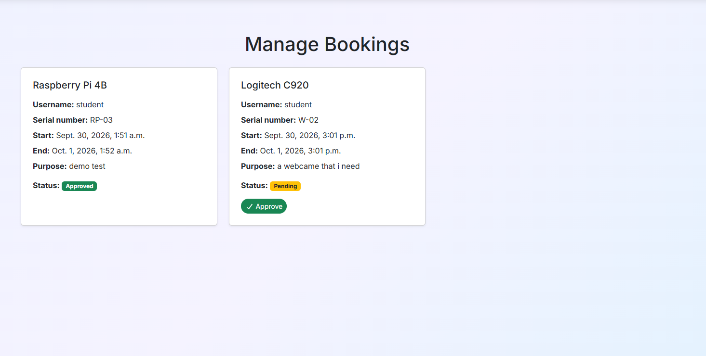
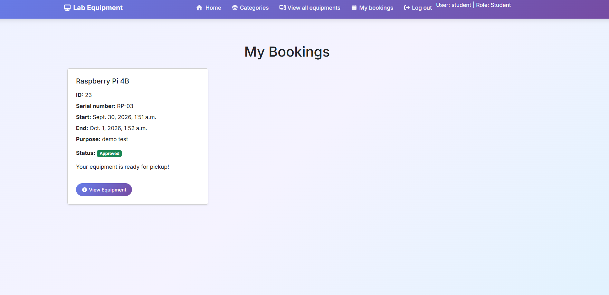
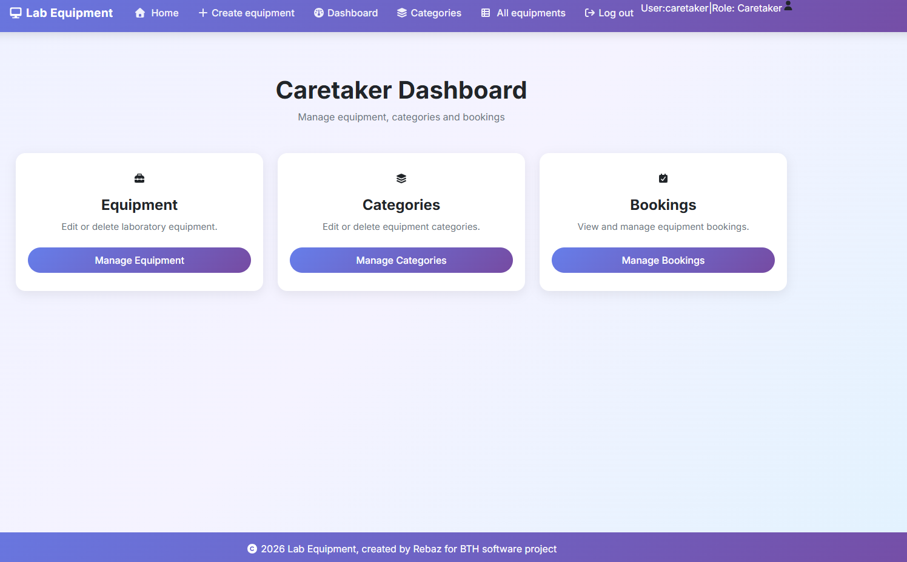

# PA1493 Software Development Project (Distance) HT26

---

## Project Description

**Project Name:** *Lab Equipment Knowledge Hub (LEKH)*

**Customer Name:** *Zeth Danielsson*

**Student Full Name:** *Rebaz Mohammad Ahmad*

### Project Aim and Objectives

* Project is about learning to work in an agile environment
* Plan a software project with the intention of following the
  planned sprints.
* Learn to prioritize software work.
* Learn to fullfill requirements from customer. 

### User Personas

| Name | Characteristics | Needs and Expectations | How will they use the system? |
|---|---|---|---|
| *John Doe* | *Age: 20, background: student, technical skill level 6/10, etc.* | *Need to quickly find avalible equitment for projects without unnecessary paperwork, expects clear instruction about equipment condition* | *Search for equipment,report faults, check availability* |

| Name | Characteristics | Needs and Expectations | How will they use the system? |
|---|---|---|---|
| *Alice* | *Age: 35, background: caretaker, technical skill level 5/10, etc.* | *Needs an overview of borrowed equipment, stocks and overdue items * | *Register equipment,update status, approve or reject borrowed items * |

### Software Requirements

**Functional Requirements**
- *User registration and login, User can register using email, username and password*

- *Diffrent user permissions, The system supports student,admin and caretaker roles*

- *Equipment registration, caretaker registers name, category, description, location and status.*

- *Equipment handling and categories, caretaker will create,read,update and delete the equipments and categories.*

- *Booking equipment, students can book an equipment in a form that will be displayed to caretaker.*

- *Equipment viewing, caretaker and students will be able to view detalied page of each equipment.*

- *Equipment search and filtering, students must be able to search by name and filter by category*

- *Equipment fault reporting, students can report faults on diffrent equipment, caretaker will be able to view the reported fault.*

- *Uploading Equipment images, caretakers can upload images and pdf files.*

**Non-Functional Requirements**
- *Security, system have the right auth permission for the right roles: "students and caretakers".*

- *Data validation, system should validate inputed data when using login, register account and crud operations*

- *Usability, the system should have a consistent interface.*

- *The system should support diffrent formats like tablets and mobile screens.*

- *Images should be optimized for performance and loading times.*

---

## Backlog

### 1. GitHub Issues (the content)

Link to Github issues for this project can be found here:
[Github Issues for this project](https://github.com/dipt-pa1493-ht26/pa1493-reah23-lekh-zda/issues)

Link to the Agile backlog for this project:
[Github Agile board](https://github.com/orgs/dipt-pa1493-ht26/projects/10/views/1)

---

## Database relations and modeling

The Database for the application can be viewed from the image below:

## Features and functionality

### Authentication and user mangement

* Registration - Students can create  account to access the system.
* Login/logout - Users can securely login/logout.
* User roles - Users have diffrent permission based on their role, students, caretaker and admin.
* Role management - Administrators can assign diffrent permission roles to the users.

Create account:

Login:

Mange roles:

### Equipment management

* Equipment overview - Users can view all the equipment.

* Equipment Detail - Users can view detalied information in the overview when clicking a link.

* Equipment categories - Equipment are grouped into categories for easiser navigation.

* Equipment status - Equipment can be marked as avalible, on loan, in repair or out of service.

* Equipment management - Caretaker can add, edit and delete equipments.

* Availability - Students can view how many equipments are avalible at the moment and how many are on loan.

View all equipment:

View detailed equipment:

View categories

Clicked categories:

View equipment types after categories

Clicked equipment types

Equipment status:

Equipment create, read, update and delete:

### Booking system

* Booking - Students can request booking equipments.

* Booking approval - Caretaker can approve or reject from students booking.

* My bookings - Students can view their booking when its been approved from caretaker.

* Mange bookings - Caretaker can see all the bookings from students in the caretaker dashboard page.

Caretaker views the booking from students and approve:

Students can see all the made bookings that the student have made:

### Caretaker dashboard page

* Mange bookings - Only caretaker can see all the bookings from students in the caretaker dashboard page.

* Mange categories - Only caretaker can edit categories.

* Mange equipments - Only caretaker can create/edit/delete equipments from the caretaker page.

Caretaker dashboard page:

Caretaker edit category page:

### User interface

* Responsiv - The system is designed to be used also on mobile and tablet screens.

* Success messages - The system displays diffrnet messages when a form is submited.

Mobile screens examples:

## User manual

### Installing
- Python 3.14.2
- Git
- Visual studio code

  #### 1. Clone the repository
  * git clone https://github.com/dipt-pa1493-ht26/pa1493-reah23-lekh-zda
  * cd project name

  #### 2. Create and activate virtual enviorment.
  * python -m venv .venv
  * Run .venv\Scripts\Activate to activate the virtual enviorment.
  * To deactivate, run deactivate to close the terminal for the virtual enviorment
  * Windows: .venv\Scripts\activate
  * Mac/Linux source: .venv/bin/activate
 

  #### 3. Install dependencies
  * When virtual enviorment is green and activated run the following: pip install -r requirements.txt to install all the dependencies.

  
  #### 4 Enviorment variables
  Project requires Django enviorment variables. Create an env.py file in the same folder as manage.py and add the following:
  
  * SECRET_KEY = your-secret-key

  * CLOUDINARY_URL = your cloudinary secret api key 

### Running the app first time

  * Apply database migration first by running "python manage.py migrate in the root folder (same folder as manage.py)"

  * Create admin account by running "python manage.py createsuperuser"

  * To start the application run: "python manage.py runserver" in the root folder.

  * When migrations are completed only "python manage.py runserver" is needed to run the application in the root folder.

### Used Technology

1. Django==6.1.1

* Webframe used for building the application, models, views url and database functions.

2. django-allauth==65.19.3

* Used for handling authentication

3. django-cloudinary-storage==0.3.0
* Used for connection Django files and imagefileds for storing uploaded media files.
4. pillow==12.3.0

* Used for Python image handling to upload and process.

5. cloudinary==1.46.2

* Cloudbased media service for storing images.

6. HTML5

* Used for structuring the application pages.

7. CSS3

* Used for custom styles for the application.

8. whitenoise==6.12.0 

* Used for serving static files such as, Javascript, CSS and other static files.

9. Bootstrap

* Used for responsiv mobile design and some styling.